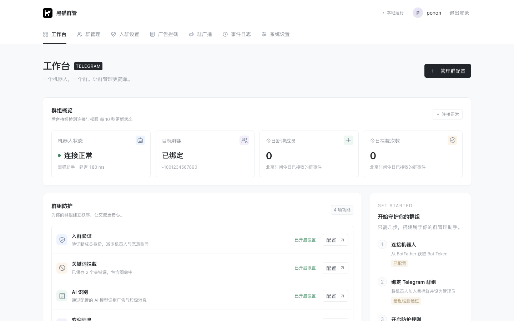
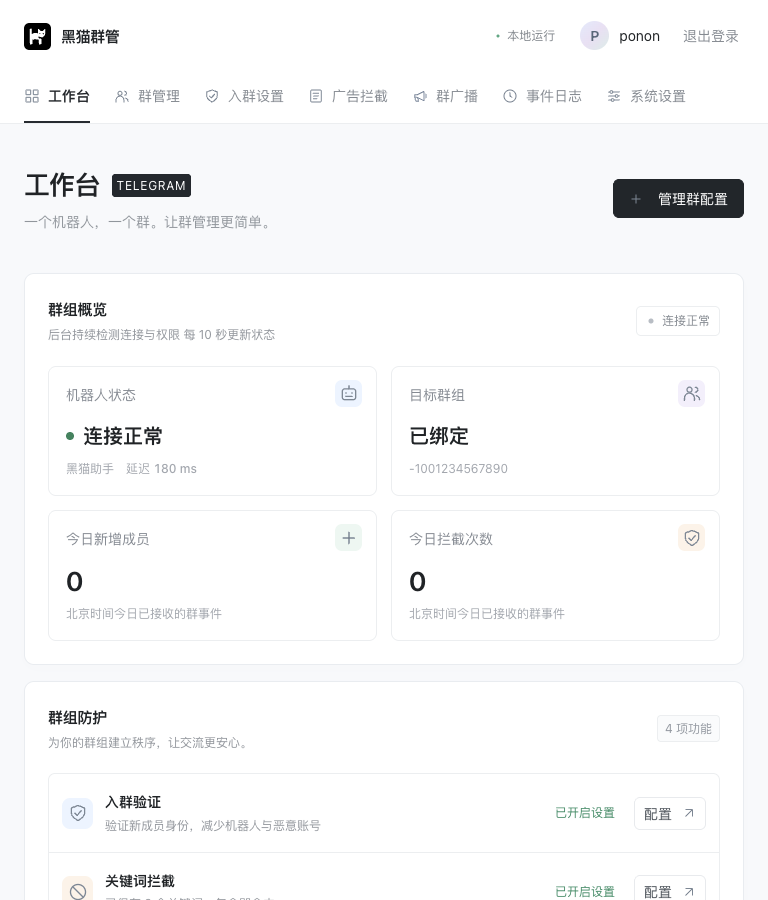
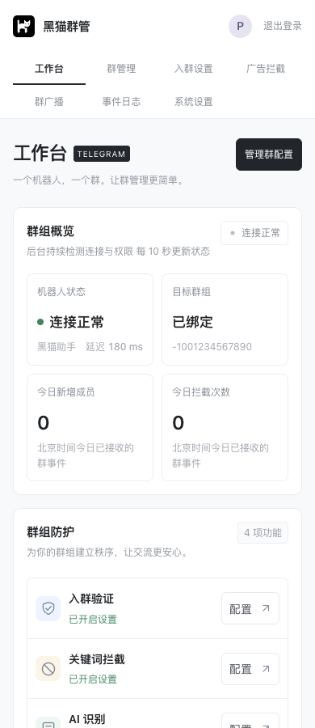

<div align="center">
  
  <h1>黑猫群管 · BlackCatGuard</h1>
  <p>基于现代 Python Web 技术栈的 Telegram 群管理工具</p>
  <p>入群验证 · 欢迎消息 · 广告拦截 · 循环广播 · 事件推送</p>
  <p>
    <a href="./LICENSE"></a>
    <a href="https://github.com/Ponon/BlackCatGuard/stargazers"></a>
    <a href="https://github.com/Ponon/BlackCatGuard/forks"></a>
    
    
    
  </p>
  <p>
    <a href="#界面预览">界面预览</a> ·
    <a href="#功能介绍">功能介绍</a> ·
    <a href="#快速开始">快速开始</a> ·
    <a href="./docs/usage.md">使用指南</a> ·
    <a href="#特别感谢">特别感谢</a> ·
    <a href="#star-趋势">Star 趋势</a>
  </p>
</div>

## 项目介绍

**黑猫群管（BlackCatGuard）** 是一个开源、可自行部署的 Telegram 群管理工具。通过现代化的 Web 管理界面，完成入群验证、欢迎消息、关键词与 AI 广告拦截、定时广播及事件通知的配置。

- **多端适配**：支持桌面、平板和手机，在不同屏幕上管理群组
- **现代技术栈**：Python 3.13、FastAPI、Tortoise ORM 和 Jinja2，采用异步服务处理群事件与后台任务
- **轻量部署**：SQLite 本地存储，原生 HTML / CSS / JavaScript，无需额外构建前端；提供 Docker 镜像
- **持续运行**：关闭网页后后台继续工作，断网时保留功能配置，连接恢复后自动继续

当前采用 **一个机器人绑定一个群组** 的设计，配置、日志与任务数据保存在部署设备上。

## 界面预览

以下为使用示例数据展示的实际界面。

### 桌面端

完整工作台，集中查看连接状态、群组统计和已开启的防护功能。



### 平板与手机端

根据屏幕宽度调整布局、导航和信息密度，支持移动端配置与日常查看。

<table>
  <tr>
    <th width="66%">平板端</th>
    <th width="34%">手机端</th>
  </tr>
  <tr>
    <td valign="top"></td>
    <td valign="top"></td>
  </tr>
</table>

## 功能介绍

| 模块 | 功能 |
| --- | --- |
| 工作台 | 实时连接状态、请求延迟与动态指示点、今日新增与拦截统计、最新 5 条事件 |
| 群管理 | 配置 Bot Token 与群 ID、保存后自动检测机器人连接和管理员权限 |
| 入群验证 | 按钮验证、随机算术题，支持验证超时及回答错误处置 |
| 入群欢迎 | 独立开关、自定义欢迎语、昵称和用户名变量、延时删除 |
| 广告拦截 | 关键词包含匹配、OpenAI 兼容 AI 识别、用户白名单、消息与成员处置 |
| 群广播 | 保存多条内容、配置链接按钮、每天多个时间点或按分钟间隔发送 |
| 事件日志 | 按时间查看类型、昵称、用户 ID、事件与内容，页码分页及确认清空 |
| 系统设置 | 统一 HTTP/HTTPS 代理、日志保留天数、修改管理员账号、Bark 推送及类型选择 |

## 快速开始

任选一种方式启动，默认端口为 **1777**。

### 方式一：Docker 镜像部署

将以下内容保存为 `docker-compose.yml`，也可以直接粘贴到支持 Compose 的容器管理面板：

```yaml
services:
  blackcatguard:
    container_name: blackcatguard
    image: ghcr.io/ponon/blackcatguard:latest
    environment:
      APP_ACCESS_URL: "http://${ACCESS_HOST:-宿主机IP}:${PORT:-1777}"
    restart: unless-stopped
    init: true
    ports:
      - "${PORT:-1777}:1777"
    volumes:
      - data:/app/data
    extra_hosts:
      - "host.docker.internal:host-gateway"
    stop_grace_period: 30s

volumes:
  data:
```

```bash
docker compose -f docker-compose.yml up -d
```

访问 `http://服务器IP:1777`。如需修改映射端口，在 Compose 文件旁的 `.env` 中设置 `PORT=1888`，然后访问 `http://服务器IP:1888`。设置 `ACCESS_HOST=服务器IP或域名` 可让启动日志显示对应地址；使用 HTTPS 反向代理时，将 `APP_ACCESS_URL` 改为实际访问网址。

配置与数据库保存在独立数据卷中，更新镜像不会清空数据。更新命令：

```bash
docker compose -f docker-compose.yml pull
docker compose -f docker-compose.yml up -d
```

### 方式二：从源码构建 Docker 镜像

```bash
git clone https://github.com/Ponon/BlackCatGuard.git
cd BlackCatGuard
docker compose -f compose.yaml up -d --build
```

访问 `http://服务器IP:1777`。

### 方式三：Python 直接运行

需要 Python **3.13**，以下命令适用于 Linux / macOS：

```bash
git clone https://github.com/Ponon/BlackCatGuard.git
cd BlackCatGuard
python3 -m venv .venv
.venv/bin/python -m pip install -r requirements.txt
.venv/bin/python -m uvicorn main:app --host 0.0.0.0 --port 1777 --workers 1
```

访问 `http://服务器IP:1777`，本机使用 `http://127.0.0.1:1777`。正式运行使用单实例、单 worker，不启用热重载。

### 首次配置

1. 同意使用须知并创建管理员账号
2. 如需代理，在系统设置中保存 HTTP/HTTPS 代理地址
3. 在群管理中填写 Bot Token 与群 ID，将机器人设为群管理员并检测连接
4. 按需开启入群验证、欢迎语、广告拦截及广播任务

Docker 内的 `127.0.0.1` 指容器自身；使用宿主机代理时填写 `http://host.docker.internal:代理端口`，并确保代理允许容器访问。Bark 始终直连。

更多配置、故障恢复、使用边界与备份方法，见 [使用指南](./docs/usage.md)。

## 开发与贡献

欢迎通过 [Issues](https://github.com/Ponon/BlackCatGuard/issues) 提交问题，通过 [Pull Requests](https://github.com/Ponon/BlackCatGuard/pulls) 贡献代码。反馈问题时请附上复现步骤和脱敏后的错误信息。

```text
├── dao/          # 数据模型与数据库升级
├── routers/      # 页面及配置接口
├── services/     # Telegram、验证、拦截、广播和推送服务
├── templates/    # Jinja2 页面模板
├── static/       # 样式、脚本与图标
├── tests/        # 自动化测试
├── utils/        # 安全、时间与模板工具
└── main.py       # 应用入口与后台服务生命周期
```

测试使用内存或临时数据库与模拟网络，不向真实群发送消息，也不调用真实 AI、Bark 服务。JavaScript 检查需要本机安装 Node.js：

```bash
.venv/bin/python -m unittest discover -s tests -q
node tests/test_form_state.js
node tests/test_toast.js
node tests/test_dashboard_live.js
node tests/test_navigation.js
```

## 特别感谢

<table>
  <tr>
    <td align="center" width="140">
      <a href="https://github.com/Barryliu">
        <br>
        <strong>Barryliu</strong>
      </a>
    </td>
  </tr>
</table>

也感谢以下开源项目及其维护者：

[FastAPI](https://github.com/fastapi/fastapi) · [Tortoise ORM](https://github.com/tortoise/tortoise-orm) · [Jinja](https://github.com/pallets/jinja) · [Bark](https://github.com/Finb/Bark) · [Star History](https://github.com/star-history/star-history)

## Star 趋势

感谢每一位关注和支持黑猫群管的朋友。

<a href="https://www.star-history.com/?repos=Ponon%2FBlackCatGuard&amp;type=date&amp;legend=top-left">
  <picture>
    <source media="(prefers-color-scheme: dark)" srcset="https://api.star-history.com/chart?repos=Ponon%2FBlackCatGuard&amp;type=date&amp;theme=dark&amp;legend=top-left">
    <source media="(prefers-color-scheme: light)" srcset="https://api.star-history.com/chart?repos=Ponon%2FBlackCatGuard&amp;type=date&amp;legend=top-left">
    
  </picture>
</a>

图表由 [Star History](https://www.star-history.com/blog/how-to-use-github-star-history/#how-to-embed-the-chart-in-your-readme) 提供，读取公开仓库的实际数据；展示情况取决于仓库公开状态和图表服务可用性。点击图表可打开趋势详情。

## 许可证

本项目采用 [MIT License](./LICENSE) 开源，版权归 Ponon 所有。使用、修改或分发时，请保留版权声明和许可证全文。
